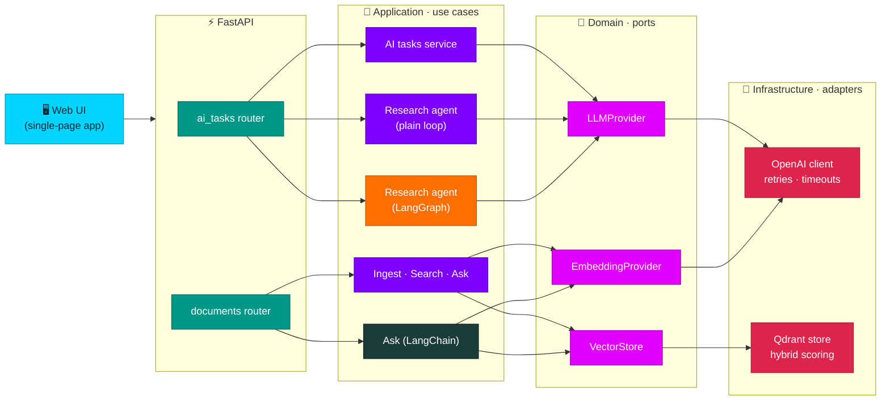
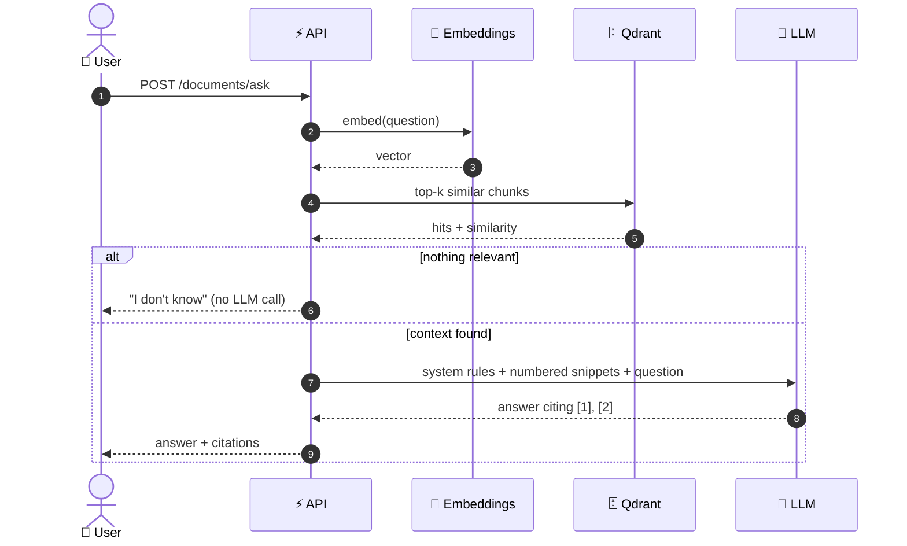
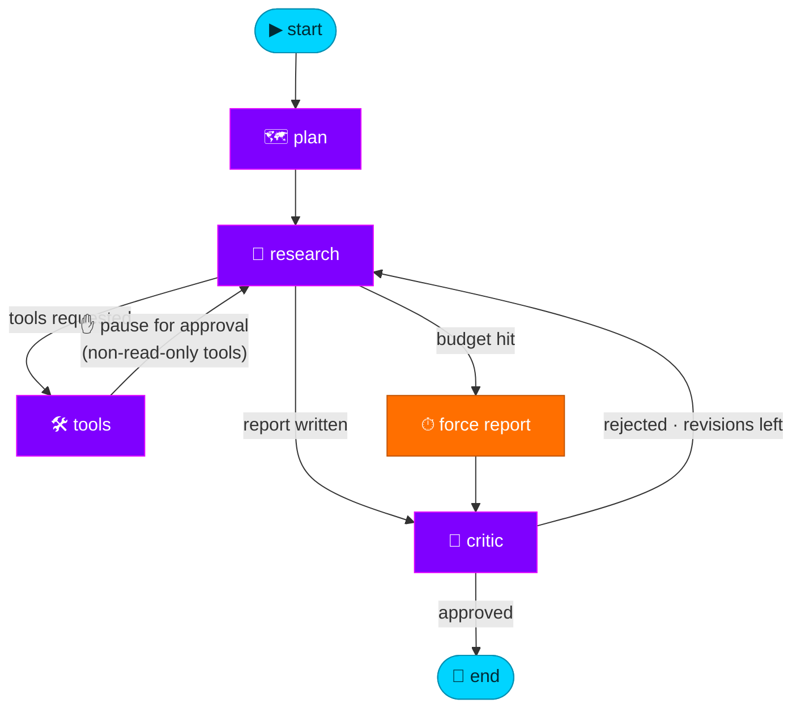

<!-- ═══════════════════════════════ HERO ═══════════════════════════════ -->

<div align="center">


<a href="#-quick-start">
  
</a>

<br/>


<br/>


<br/>


<br/><br/>

**[✨ Features](#-features) · [🏛 Architecture](#-architecture) · [🚀 Quick Start](#-quick-start) · [📡 API](#-api-reference) · [⚙️ Config](#%EF%B8%8F-configuration) · [📚 Docs](#-deep-dive-docs)**

</div>


## 💡 What It Is

**Agentic AI Core** is an async AI backend that packages the pieces most production AI apps need —
LLM text tools, tool calling, document ingestion, vector search, grounded RAG answers,
and multi-step research agents — behind a clean **Domain-Driven + Hexagonal** architecture.

It ships with a **built-in single-page web UI**, so every endpoint can be tried straight from the browser.
No separate frontend server needed.

> [!TIP]
> Several features exist in **two flavors side by side** — hand-written and framework-based —
> so you can compare plain Python against **LangChain** and **LangGraph** on the same data.


## ✨ Features

<table>
<tr>
<td width="33%" valign="top">

### 🧠 LLM Text Tools
Ask, **streaming** ask, sentiment classification, summarize, keyword extraction,
translation, and combined text analysis — all with **structured JSON** output.

</td>
<td width="33%" valign="top">

### 🔍 Hybrid Search
Semantic vector search over Qdrant, blended with **keyword matching**,
filename filters, and a minimum-similarity threshold.

</td>
<td width="33%" valign="top">

### 📚 Grounded RAG
Answers built **only** from your documents with numbered **citations**.
Nothing relevant found? It honestly says **"I don't know"**.

</td>
</tr>
<tr>
<td width="33%" valign="top">

### 🛠 Safe Tool Calling
The model picks tools (weather, doc search, ticket & email **drafts**).
Every call is validated, risk-tagged, size-limited, and audited.

</td>
<td width="33%" valign="top">

### 🤖 Research Agent
`plan → act → observe → reflect` loop with hard **iteration and token budgets**,
self-critique, and a full step-by-step trace.

</td>
<td width="33%" valign="top">

### 🕸 LangGraph Agent
The same agent as a **graph**: the critic can send reports back for revision,
and runs **pause for human approval** before risky tools.

</td>
</tr>
<tr>
<td width="33%" valign="top">

### ⛓ LangChain RAG
The RAG pipeline rebuilt as an LCEL chain —
`retriever → prompt → LLM` — reading the same Qdrant data.

</td>
<td width="33%" valign="top">

### 🛡 Reliability
Retries with **exponential backoff**, timeouts, fail-fast config validation,
and provider errors mapped to clean HTTP codes.

</td>
<td width="33%" valign="top">

### 📈 Observability
Structured logs with `request_id`, model, latency, tokens,
similarity scores, and chunk counts — secrets never logged.

</td>
</tr>
</table>


## 🏛 Architecture

Two bounded contexts — **`ai_tasks`** and **`documents`** — isolated behind ports and adapters.
Swap OpenAI or Qdrant without touching domain logic.



<details>
<summary><b>📚 RAG pipeline — click to expand</b></summary>
<br/>



</details>

<details>
<summary><b>🕸 LangGraph research agent — click to expand</b></summary>
<br/>



</details>


## 🚀 Quick Start

```bash
# 1️⃣  Install (Poetry)
poetry install

# 2️⃣  Configure — then set OPENAI_API_KEY in .env
cp .env.example .env

# 3️⃣  Start Qdrant (needed for search & RAG)
docker compose up -d qdrant

# 4️⃣  Run the API
poetry run uvicorn app.main:app --reload
```

<div align="center">

| 🌐 Surface | 🔗 URL |
| :---: | :---: |
| **Web UI** | `http://127.0.0.1:8000/` |
| **API** | `http://127.0.0.1:8000` |
| **OpenAPI docs** | `http://127.0.0.1:8000/docs` |

</div>

> [!NOTE]
> `.env` is git-ignored. Settings are validated at startup, so the app **fails fast** if `OPENAI_API_KEY` is missing.

<details>
<summary><b>🐳 Run everything in Docker</b></summary>
<br/>

```bash
docker compose up --build -d   # app + Qdrant
docker compose down            # stop
```

</details>

<details>
<summary><b>🧪 Tests, lint & types</b></summary>
<br/>

```bash
make test-unit     # unit tests
make test-api      # API router tests
make test          # full suite (unit + api + integration)
make lint          # ruff
make typecheck     # mypy
make check         # read-only CI gate: lint + format check + types + coverage
```

</details>


## 📡 API Reference

Interactive docs live at **`/docs`**. Ready-to-run `curl` examples for every endpoint:
[`doc/1. API_CURL_EXAMPLES.md`](doc/1.%20API_CURL_EXAMPLES.md).

### 🧠 AI Tasks

| Method | Endpoint | Description |
| :---: | --- | --- |
|  | `/health` | Liveness check |
|  | `/ask` | Ask a question and get a single answer |
|  | `/ask-stream` | Same as `/ask`, streamed token-by-token |
|  | `/classify` | Sentiment classification as structured JSON |
|  | `/summarize` | 2–3 sentence summary |
|  | `/extract-keywords` | Key terms as structured JSON |
|  | `/translate` | Translate text to a target language |
|  | `/analyze-text` | Combined summary, sentiment, keywords, and language |
|  | `/tool-assistant` | Assistant that can call safe backend tools |

### 🤖 Agents

| Method | Endpoint | Description |
| :---: | --- | --- |
|  | `/research-agent` | Multi-step research agent: report plus full trace |
|  | `/research-agent-langgraph` | LangGraph agent: critic revision loop, pauses for human approval |
|  | `/research-agent-langgraph/resume` | Approve or reject a paused run's tool calls and continue it |

### 📚 Documents · Search & RAG

| Method | Endpoint | Description |
| :---: | --- | --- |
|  | `/documents/upload` | Upload `.txt` / `.pdf`, chunk, embed, and store in Qdrant |
|  | `/documents/search` | Vector search with optional keyword search and filters |
|  | `/documents/ask` | RAG answer grounded in your docs, with citations |
|  | `/documents/ask-langchain` | Same RAG answer, pipeline built with LangChain |


## ⚙️ Configuration

All settings come from environment variables or `.env`, validated by `pydantic-settings`.
Source of truth: [`app/shared/config.py`](app/shared/config.py).

<details>
<summary><b>🔧 Show all settings</b></summary>
<br/>

| Variable | Purpose | Default |
| --- | --- | --- |
| `OPENAI_API_KEY` | OpenAI credentials, **required** | – |
| `OPENAI_MODEL` | Chat model | `gpt-4o-mini` |
| `OPENAI_EMBEDDING_MODEL` | Embedding model | `text-embedding-3-small` |
| `OPENAI_TEMPERATURE_*` | Per-task temperatures for classify, summarize, and other tasks | task-specific |
| `OPENAI_TIMEOUT_SECONDS` / `OPENAI_MAX_RETRIES` | Reliability knobs | `20` / `2` |
| `QDRANT_URL` / `QDRANT_COLLECTION_NAME` | Vector store target | `localhost:6333` / `documents` |
| `DOCUMENT_CHUNK_SIZE` / `DOCUMENT_CHUNK_OVERLAP` | Chunking behaviour | `500` / `100` |
| `RAG_TOP_K` / `RAG_MIN_SIMILARITY` | Retrieval tuning | `4` / `0.2` |
| `RAG_TEMPERATURE` / `RAG_MAX_TOKENS` | Answer generation | `0.1` / `500` |
| `AGENT_MAX_ITERATIONS` / `AGENT_MAX_TOTAL_TOKENS` | Research-agent safety budgets | `6` / `12000` |
| `AGENT_TEMPERATURE` / `AGENT_REPORT_MAX_TOKENS` | Agent sampling and final report size | `0.1` / `800` |
| `AGENT_ENABLE_REFLECTION` | Run the agent's self-critique pass | `true` |
| `AGENT_MAX_REVISIONS` | Extra research rounds the LangGraph critic may request | `1` |
| `PROMPT_*_SYSTEM` | Tunable system prompts per task | sensible defaults |

Prompts are versioned in `app/domains/ai_tasks/domain/prompts.py` — bump a prompt's
`version` when you change its wording meaningfully.

</details>


## 📈 Observability

| Signal | Details |
| --- | --- |
| 🆔 **Request identity** | `request_id`, also returned in the `x-request-id` response header |
| 🧠 **Model activity** | endpoint name, model name, latency, and token usage |
| 📄 **Document ingestion** | chunk counts for uploads |
| 🎯 **Search quality** | similarity scores and search latency |
| 🚨 **Failures** | errors, mapped to clean HTTP status codes |

> [!IMPORTANT]
> Sensitive values such as `OPENAI_API_KEY` are **never** logged.


## 📚 Deep-Dive Docs

| | Topic |
| :---: | --- |
| 📖 | [Glossary](doc/0.%20GLOSSARY.md) |
| 🧪 | [API curl examples](doc/1.%20API_CURL_EXAMPLES.md) |
| 🛠 | [Tool calling](doc/2.%20TOOL_CALLING.md) |
| 🔍 | [Semantic search](doc/3.%20DOCUMENTS_SEMANTIC_SEARCH.md) |
| 🗄 | [Qdrant](doc/4.%20Qdrant.md) |
| 📚 | [RAG pipeline](doc/5.%20RAG_PIPELINE.md) |
| ⛓ | [LangChain](doc/6.%20LANGCHAIN.md) |
| 🕸 | [LangGraph](doc/7.%20LANGGRAPH.md) |

## ⚠️ Current Limitations

- Qdrant must be running for upload, search, and ask.
- Upload supports `.txt` and text-based `.pdf` only — scanned PDFs are not OCR'd.
- Paused LangGraph runs are kept in memory and are lost on restart.

<!-- ═══════════════════════════════ FOOTER ═══════════════════════════════ -->

<div align="center">

<br/>

**Built with ❤️ by [Ervand Agadzhanyan](https://github.com/ervand7)**


</div>
