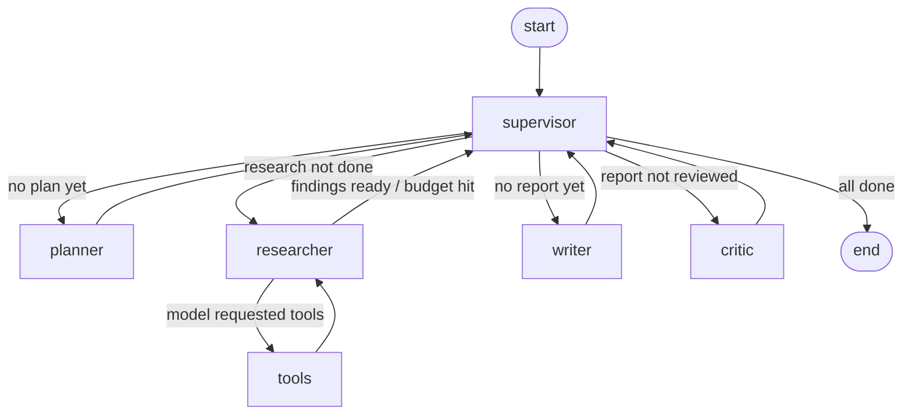

# LangGraph — The Research Agent as a Multi-Agent Graph

**LangGraph** builds agents as a **graph**: each step is a *node*, arrows
between steps are *edges*, and all nodes read and update one shared *state*.
The state is saved (*checkpointed*) after every step, so a run can pause and
continue later — even after a server restart.

This project has the research agent twice:

```http
POST /research-agent                    # plain Python loop
POST /research-agent-langgraph          # LangGraph graph
POST /research-agent-langgraph/resume   # continue a paused graph run
```

Both use the same planner, prompts, tools, and budgets. The LangGraph service
(`langgraph_research_agent_service.py`) extends `ResearchAgentService` and
reuses its steps, so only the orchestration differs.

---

## The graph: supervisor + workers



| Node | Role |
|---|---|
| `supervisor` | Reads the shared state and hands off to the next worker (`Command(goto=...)`). No LLM call. |
| `planner` | Asks the model for an ordered research plan (structured JSON). |
| `researcher` | One reasoning step: the model either requests tools or reports its findings. |
| `tools` | Executes requested tools. **Pauses for human approval** before non-read-only tools. |
| `writer` | Final answer generator: turns findings + tool evidence into the report. |
| `critic` | Reviews the report. If rejected, the supervisor sends the researcher back. |

With `AGENT_ENABLE_REFLECTION=false` the supervisor never calls the `critic`.

### Why the supervisor is rule-based

The supervisor routes on state (`plan`, `research_done`, `report`, `reviewed`)
instead of asking an LLM "who goes next?". The workflow order is fixed, so an
LLM supervisor would only add cost, latency, and a way to pick the wrong worker.
An LLM-routed supervisor is worth it when workers are optional and the right
one depends on the request (e.g. "billing agent" vs "tech support agent").

---

## What is new compared to the plain loop

### 1. Separate worker roles

The plain agent writes the report inside its loop. Here the **researcher** only
gathers evidence and summarizes findings; the **writer** gets the findings plus
all executed tool results and writes the report with its own prompt
(`PROMPT_RESEARCH_AGENT_WRITER_SYSTEM`). When a budget cuts research short, the
writer is told so and writes the best report from what was gathered.

### 2. Critic revision loop

A rejected report goes **back to the researcher** with the critic's issues, so
the agent can search again; then the writer rewrites. `AGENT_MAX_REVISIONS`
(default `1`) caps the extra rounds; after that, the critic's own revised
answer is used.

### 3. Human-in-the-loop approval

Before running any tool that is not `read_only` (e.g. `create_ticket`), the
`tools` node calls LangGraph's `interrupt()`. The run stops and the API returns:

```json
{ "status": "awaiting_approval", "thread_id": "...", "pending_tool_calls": [...] }
```

`POST /research-agent-langgraph/resume` with `{"thread_id": "...", "approved": true}`
continues the **same run** from that exact point (`Command(resume=True)`).
With `approved: false` the tools are skipped and the model is told they were
rejected.

### 4. Persistent checkpointing by `thread_id`

Every step's state is saved under the run's `thread_id` in Postgres
(`AsyncPostgresSaver`, URL `LANGGRAPH_POSTGRES_URL`). That is what makes
pause/resume possible, and paused runs **survive a restart**: start a run,
restart the server, then resume it. Because the state lives in a shared
database, any app replica can resume any run.

The app opens a connection pool in its lifespan (`langgraph_lifespan`), creates
the checkpoint tables on startup (`setup()`), and closes the pool on shutdown.
An empty `LANGGRAPH_POSTGRES_URL` falls back to `InMemorySaver` (used by unit
tests; runs are then lost on restart).

### 5. Node retries

LLM nodes (`planner`, `researcher`, `writer`, `critic`) have a LangGraph
`RetryPolicy`: on a transient provider error (timeout, rate limit, temporary
failure) the **whole node** re-runs, up to `AGENT_NODE_MAX_ATTEMPTS`, with
exponential backoff. This is on top of the OpenAI client's own per-request
retries. The `tools` node is not retried: tools may have side effects and it
holds the approval interrupt. Other errors (bad request, invalid output) fail
fast.

---

## Core concepts in the code

```python
graph = StateGraph(ResearchGraphState)              # shared state (dataclass)
graph.add_node("supervisor", self._supervisor_node, destinations=WORKER_NODES)
graph.add_node("writer", self._writer_node, retry_policy=llm_retry)
graph.add_edge("writer", "supervisor")              # fixed edge
graph.add_conditional_edges(                        # routing decided by state
    "researcher", self._after_researcher, ["tools", "supervisor"]
)
self._graph = graph.compile(checkpointer=checkpointer)
```

- **Node:** `async def node(state, config) -> dict`. It returns only the keys it changes.
- **Handoff:** a node returns `Command(goto="writer")` to choose the next node itself.
- **Conditional edge:** a function that reads the state and returns the next node name.
- **`RetryPolicy`:** per-node retries with backoff, filtered by exception type.
- **`interrupt(value)`:** pauses the run. On resume the node re-runs and `interrupt` returns the human decision.
- **`thread_id`:** passed in `config["configurable"]`. It identifies which saved run to continue.
