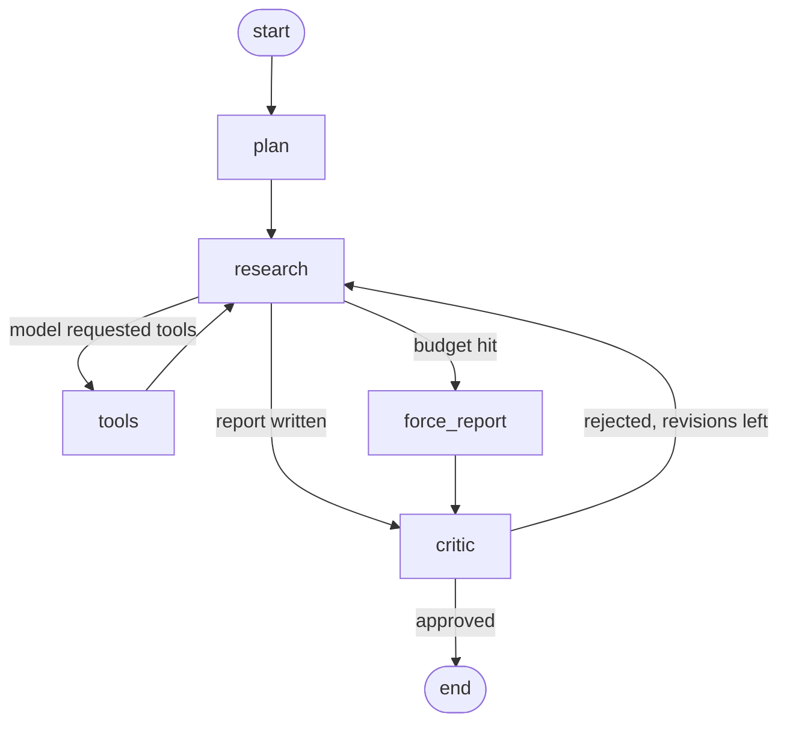

# LangGraph — The Research Agent as a Graph

**LangGraph** builds agents as a **graph**: each step is a *node*, arrows
between steps are *edges*, and all nodes read and update one shared *state*.
The state is saved (*checkpointed*) after every step, so a run can pause and
continue later.

This project has the research agent twice:

```http
POST /research-agent                    # plain Python loop
POST /research-agent-langgraph          # LangGraph graph
POST /research-agent-langgraph/resume   # continue a paused graph run
```

Both use the same planner, prompts, tools, and budgets. The LangGraph service
(`langgraph_research_agent_service.py`) extends `ResearchAgentService` and
reuses its steps, so only the orchestration differs.

---

## The graph



| Node | What it does |
|---|---|
| `plan` | Asks the model for an ordered research plan (structured JSON). |
| `research` | One reasoning step: the model either requests tools or writes the report. |
| `tools` | Executes requested tools. **Pauses for human approval** before non-read-only tools. |
| `force_report` | Budget (iterations/tokens) hit: write the best report from what was gathered. |
| `critic` | Reviews the report. If rejected, sends it back to `research` with the issues. |

With `AGENT_ENABLE_REFLECTION=false` the `critic` node is skipped.

---

## What is new compared to the plain loop

### 1. Critic revision loop

The plain agent's critic runs once and patches the text. Here a rejected report
goes **back to the researcher** with the critic's issues, so the agent can
search again and rewrite. `AGENT_MAX_REVISIONS` (default `1`) caps the extra
rounds; after that, the critic's own revised answer is used.

### 2. Human-in-the-loop approval

Before running any tool that is not `read_only` (e.g. `create_ticket`), the
`tools` node calls LangGraph's `interrupt()`. The run stops and the API returns:

```json
{ "status": "awaiting_approval", "thread_id": "...", "pending_tool_calls": [...] }
```

`POST /research-agent-langgraph/resume` with `{"thread_id": "...", "approved": true}`
continues the **same run** from that exact point (`Command(resume=True)`).
With `approved: false` the tools are skipped and the model is told they were
rejected.

### 3. Checkpointing by `thread_id`

Every step's state is saved under the run's `thread_id`. That is what makes
pause/resume possible. The project uses `InMemorySaver`, so paused runs are
lost on restart. For production, swap it for a persistent saver (SQLite or
Postgres) via the service's `checkpointer` argument.

---

## Core concepts in the code

```python
graph = StateGraph(ResearchGraphState)          # shared state (TypedDict)
graph.add_node("research", self._research_node)  # a node = async function
graph.add_edge("tools", "research")              # fixed edge
graph.add_conditional_edges(                     # routing decided by state
    "critic", self._after_critic, ["research", END]
)
self._graph = graph.compile(checkpointer=InMemorySaver())
```

- **Node:** `async def node(state, config) -> dict`. It returns only the keys it changes.
- **Conditional edge:** a function that reads the state and returns the next node name.
- **`interrupt(value)`:** pauses the run. On resume the node re-runs and `interrupt` returns the human decision.
- **`thread_id`:** passed in `config["configurable"]`. It identifies which saved run to continue.
